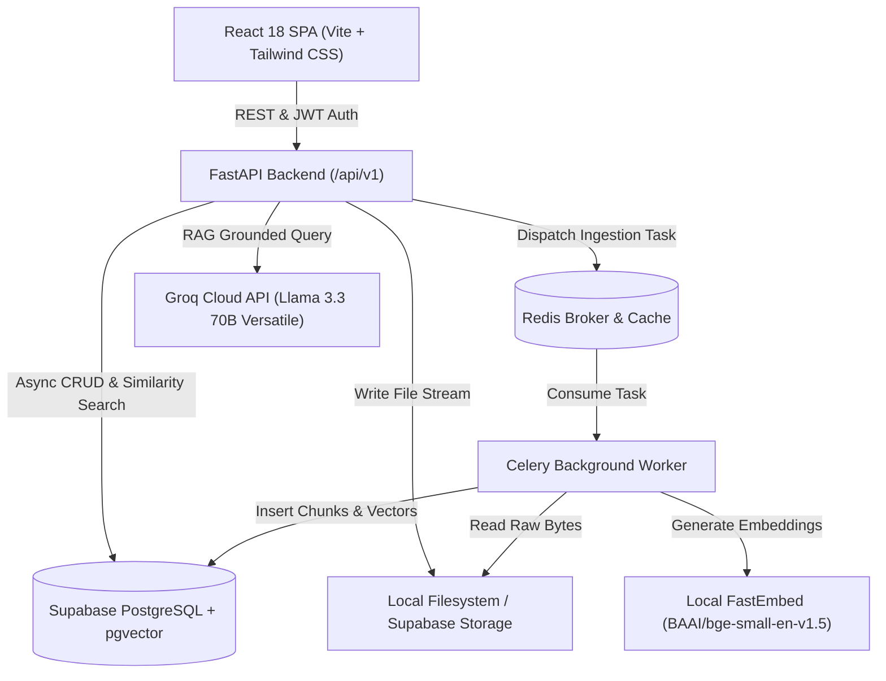

# DocRAG — Enterprise-Grade Document Intelligence Platform

DocRAG is a production-oriented document intelligence platform that enables organizations to upload complex business documents (PDF, DOCX), process their contents through asynchronous distributed pipelines, store dense vector embeddings with **PostgreSQL / pgvector**, and execute grounded **Retrieval-Augmented Generation (RAG)** queries with verifiable source citations and exact page numbers.

---

## 1. Key Features

- **Free-Tier-First Architecture**:
  - **Database & Vectors**: Supabase PostgreSQL with native `pgvector` indexing (or local PostgreSQL via Docker).
  - **LLM Generation**: Groq Cloud free tier (`llama-3.3-70b-versatile` or `llama-3.1-8b-instant`) with sub-second inference latency, plus Google Gemini fallback.
  - **Embedding Engine**: Local FastEmbed with `BAAI/bge-small-en-v1.5` (384-dimensional dense vectors, zero API cost, local ONNX CPU execution).
  - **File Storage**: Modular storage abstraction supporting local filesystem (development) and Supabase Storage (cloud free tier).
  - **Asynchronous Workers**: Celery + Redis for reliable, non-blocking ingestion and embedding generation.
- **Grounded RAG with Citations**:
  - Multi-tenant data isolation enforced directly in SQL vector queries.
  - Recursive chunking with configurable overlap preserving page-level metadata.
  - Prompt injection boundary defense (`<DOCUMENT_CONTEXT>`) protecting against adversarial document payloads.
  - Interactive, clickable citations with snippet previews and similarity scores.
  - Explicit notification when documents contain insufficient evidence.
- **Enterprise SaaS Frontend**:
  - Pure JavaScript (ES6+), React 18, Vite, and Tailwind CSS.
  - Real database-backed analytics dashboard (documents, chunks, conversations, storage).
  - Document library with real-time polling, status badges, drag-and-drop upload, retry, and preview.
  - Chat workspace with conversation history, multi-document scoping, renaming, and deletion.
- **Robust Verification**:
  - 16 backend integration/unit tests with Pytest and HTTPX.
  - 6 frontend tests with Vitest and React Testing Library.
  - Clean production build with Vite.

---

## 2. Architecture Overview



---

## 3. Repository Structure

```text
docrag/
├── backend/
│   ├── app/
│   │   ├── api/v1/          # Versioned REST endpoints (auth, documents, chat, stats, health)
│   │   ├── core/            # Configuration, JWT security, structured logging
│   │   ├── db/              # SQLAlchemy 2.0 Base, AsyncSession, SyncSession
│   │   ├── models/          # SQLAlchemy ORM models (User, Document, DocumentChunk, etc.)
│   │   ├── schemas/         # Pydantic v2 schemas for request/response validation
│   │   ├── services/        # Business logic (Extraction, Chunking, Embedding, RAG, Document)
│   │   ├── storage/         # Storage abstraction (LocalStorageProvider, S3StorageProvider)
│   │   └── workers/         # Celery application & asynchronous ingestion tasks
│   ├── alembic/             # Database migrations
│   ├── tests/               # Pytest automated test suite
│   ├── requirements.txt     # Python dependencies
│   └── Dockerfile           # Backend container definition
├── frontend/
│   ├── src/
│   │   ├── api/             # Axios API client modules
│   │   ├── components/      # Reusable UI components (Button, Input, Card, Badge, Modal)
│   │   ├── context/         # AuthContext (state management, JWT handling)
│   │   ├── pages/           # Dashboard, Documents, Chat, Profile, Login, Register
│   │   └── test/            # Vitest component test suites
│   ├── package.json         # Node.js dependencies
│   ├── vite.config.js       # Vite build configuration
│   └── Dockerfile           # Frontend Nginx production container
├── docs/                    # Technical Architecture Documentation & Design PDFs
│   ├── diagrams/            # Mermaid diagram source files (.mmd)
│   ├── 01_DocRAG_High_Level_Design.pdf
│   ├── 02_DocRAG_Low_Level_Design.pdf
│   ├── 03_DocRAG_Database_and_Storage_Design.pdf
│   ├── 04_DocRAG_AI_and_RAG_Design.pdf
│   ├── 05_DocRAG_Backend_and_Distributed_Processing.pdf
│   ├── 06_DocRAG_Security_and_Reliability.pdf
│   └── 07_DocRAG_Interview_Preparation.pdf
├── DocRAG_Technical_Documentation.pdf # Master Technical Documentation PDF
├── docker-compose.yml       # Complete multi-container deployment stack
├── .env.example             # Environment variable template with placeholders
└── README.md                # Project documentation
```

---

## 4. Quickstart & Local Setup

### Prerequisites
- Python 3.12+
- Node.js 20+ and npm
- Redis server (`redis-server`) or Docker

### 1. Backend Setup

```bash
# Create and activate virtual environment
python3 -m venv .venv
source .venv/bin/activate

# Install dependencies
pip install -r backend/requirements.txt
pip install greenlet email-validator pypdf fastembed groq

# Copy environment variables
cp .env.example .env

# Run database migrations
cd backend
alembic upgrade head
cd ..

# Start FastAPI server
PYTHONPATH=backend uvicorn app.main:app --host 0.0.0.0 --port 8000 --reload
```

The interactive OpenAPI documentation will be accessible at: `http://localhost:8000/api/v1/docs`

### 2. Frontend Setup

```bash
cd frontend
npm install
npm run dev
```

The frontend will be running at: `http://localhost:3000`

### 3. Background Celery Worker

```bash
# In a separate terminal with virtual environment active:
PYTHONPATH=backend celery -A app.workers.celery_app.celery_app worker --loglevel=info
```

---

## 5. Docker Deployment

To launch the full stack (PostgreSQL with pgvector, Redis, FastAPI backend, Celery worker, and React/Nginx frontend) in a single command:

```bash
docker compose up --build -d
```

Service mapping:
- **Frontend**: `http://localhost:3000`
- **Backend API**: `http://localhost:8000/api/v1`
- **PostgreSQL**: `localhost:5432`
- **Redis**: `localhost:6379`

---

## 6. Running Automated Tests

### Backend Test Suite (Pytest)
```bash
PYTHONPATH=backend .venv/bin/pytest backend/tests/ -v
```
*Executes 16 unit and integration tests across authentication, token refresh, document parsing, chunking, user data isolation, and RAG retrieval.*

### Frontend Test Suite (Vitest)
```bash
npm test --prefix frontend
```
*Executes Vitest component tests with React Testing Library.*

### Production Build Verification
```bash
npm run build --prefix frontend
```

---

## 7. Technical Documentation PDFs

Complete architectural specifications and interview preparation guides are generated as dedicated PDFs in `docs/`:

1. `docs/01_DocRAG_High_Level_Design.pdf`: System architecture, trust boundaries, data flows, and trade-offs.
2. `docs/02_DocRAG_Low_Level_Design.pdf`: Module decomposition, contracts, sequence flows, and design patterns.
3. `docs/03_DocRAG_Database_and_Storage_Design.pdf`: ER diagram, PostgreSQL schema, pgvector indexing, and storage.
4. `docs/04_DocRAG_AI_and_RAG_Design.pdf`: Recursive chunking, FastEmbed embeddings, and prompt-injection defense.
5. `docs/05_DocRAG_Backend_and_Distributed_Processing.pdf`: FastAPI async lifecycle, transaction-safe dispatch, and idempotency.
6. `docs/06_DocRAG_Security_and_Reliability.pdf`: Authentication, token rotation, multi-tenant isolation, and threat modeling.
7. `docs/07_DocRAG_Interview_Preparation.pdf`: System design interview questions, scalability trade-offs, and model answers.
8. `DocRAG_Technical_Documentation.pdf`: Master documentation consolidating all architectural topics.

To regenerate documentation PDFs at any time:
```bash
.venv/bin/python3 docs/generate_pdfs.py
```

---

## 8. License & Authors

DocRAG Enterprise Intelligence Platform — Built with enterprise architectural best practices.
